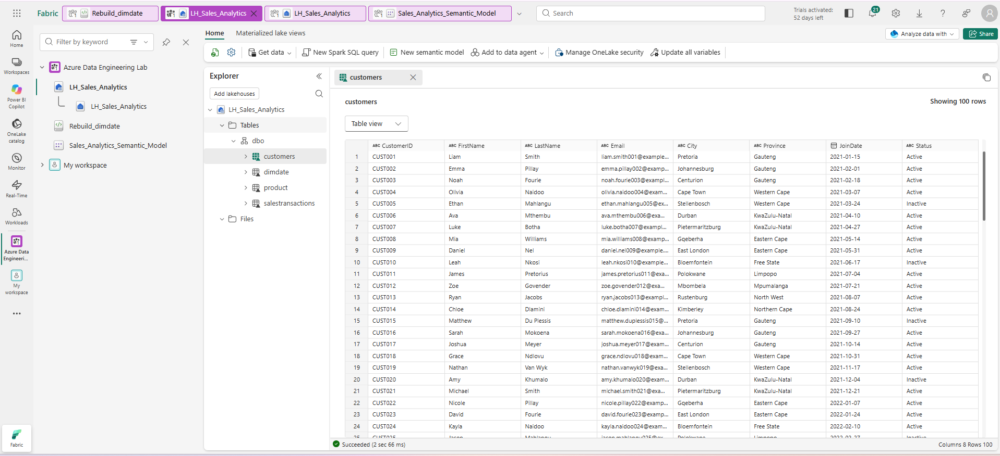
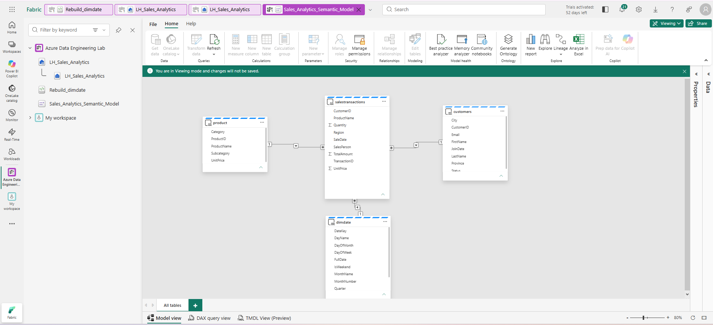
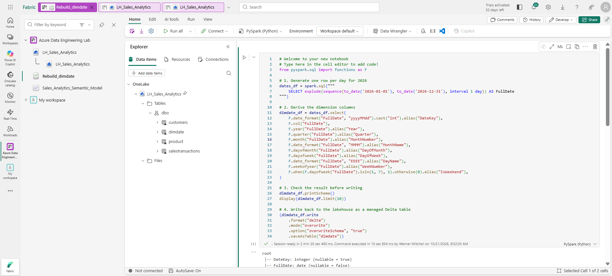
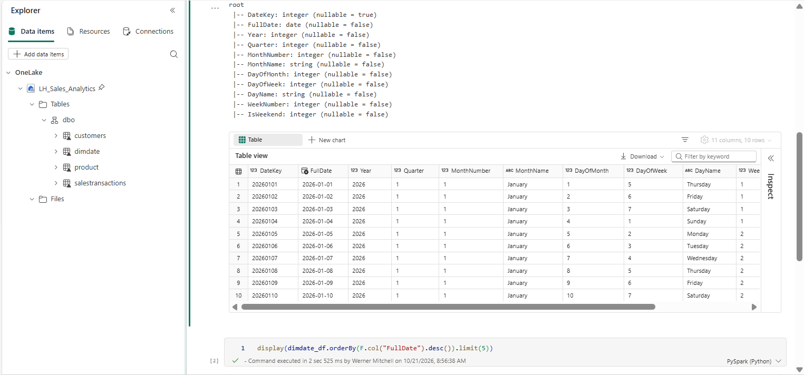

# Microsoft Fabric Sales Analytics
End-to-end fabric pipeline with Lakehouse, dataflows, and Power BI

## Overview

This project is an end-to-end data analytics solution built in Microsoft Fabric, demonstrating skills across the full pipeline from raw data to business-ready dashboards. It includes a lakehouse with a star-schema data model, a PySpark notebook for data transformation, a Power BI semantic model using Direct Lake mode, and a multi-page interactive report with KPIs, trend analysis, and breakdowns by region and product.

## Architecture / Tech Stack

Microsoft Fabric for the lakehouse and workspace environment. Azure as the source data platform. PySpark for data transformation and the date dimension rebuild. Power BI with Direct Lake mode for the semantic model. DAX for KPI measures. GitHub for version control and portfolio presentation.

## Dataset

The dataset is structured as a star schema within the lakehouse, consisting of four tables: a date dimension, a product dimension, a customer dimension, and a sales transactions fact table. The date dimension was rebuilt using a PySpark notebook to correct a date range mismatch and ensure accurate relationships with the fact table.

## Dashboard / Report Pages

The Power BI report consists of a home page with navigation buttons, an Executive Summary page featuring KPI cards for total sales revenue, units sold, distinct customers, and total transactions alongside a sales trend line chart, and a Sales Breakdown page showing sales by region and by product.

## Screenshots

Screenshots below showcase the Fabric workspace, the lakehouse tables, the notebook used to rebuild the date dimension, and the final Power BI report pages.

## Screenshots

*The Fabric lakehouse showing the star schema tables: dimdate, product, customer and sales transactions.*

*Connecting to the lakehouse via Get Data to build the Direct Lake semantic model.*

*The PySpark notebook that regenerates the dimdate table for 2026 and writes it back to the lakehouse as a Delta table.*

*The PySpark notebook that regenerates the dimdate table for 2026 and writes it back to the lakehouse as a Delta table.*
